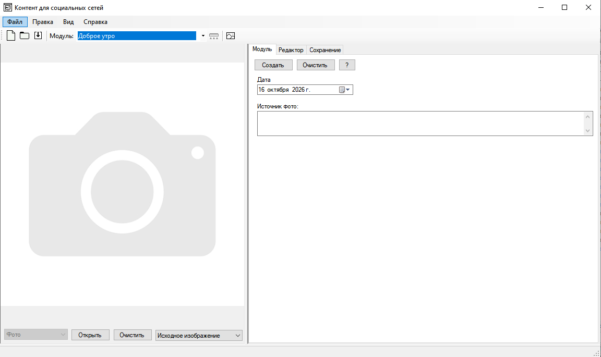
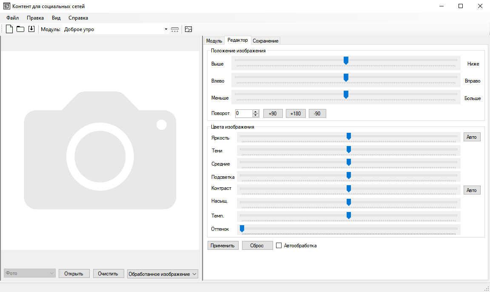

# MediaSocial

**Быстрый редактор постов для соцсетей с плагинной архитектурой.**

Создан для сообществ социальных сетей. Позволяет быстро оформлять изображения для публикаций в социальных сетях: накладывать текст, обрезать, поворачивать, корректировать яркость и контраст, а также использовать готовые шаблоны через плагины. В репозитории только код, без графических файлов и шрифтов необходимых для работы приложения.

[](LICENSE.txt)
[](https://dotnet.microsoft.com/)
[](https://docs.microsoft.com/ru-ru/dotnet/csharp/)
[](https://docs.microsoft.com/ru-ru/dotnet/desktop/winforms/)

---

## ✨ Возможности

| Категория | Что есть |
|-----------|----------|
| **Редактирование изображений** | Обрезка, поворот, изменение яркости, контраста, насыщенности, цветовой температуры, оттенка |
| **Текст и инфографика** | Наложение текста с обводкой, тенью, выравниванием, выбором шрифта и размера |
| **Плагины для типовых постов** | «Доброе утро», «Новость», «Календарь», «Погода», «Цитата», «История», «Демо», «1 изображение» и другие |
| **Загрузка данных из интернета** | Восход/закат, прогноз погоды, календарные даты |
| **Экспорт** | Сохранение в JPG, PNG, BMP с настройкой качества |
| **Плагинная архитектура** | Динамическая загрузка плагинов из DLL, интерфейс `IPlugin`, взаимодействие плагина с хостом через `IPluginHost` |

---

## 📸 Скриншоты

> Главное окно и редактор фото:
> 
> 
> 

---

## 🧩 Поддерживаемые плагины

| Плагин | Описание | Версия | Редактор |
|--------|----------|--------|----------|
| Доброе утро | Пост с информацией о восходе/закате | 1.0.0 | Да |
| Новости | Оформление новостной карточки | 1.1.0 | Да |
| Календарь | «День в календаре» | 1.0.0 | Да |
| Прогноз погоды | Информация о погоде | 1.0.0 | Нет |
| Цитата | Оформление цитаты | 1.0.0 | — |
| История | Историческая справка | 1.0.0 | — |
| Демография | Демографическая справка | 1.0.0 | — |
| Погода (ручная) | Ручной ввод погоды | 1.0.0 | — |
| Доброе утро (Новый год) | Новогодний вариант «Доброе утро» | 1.0.0 | — |
| Новости (Новый год) | Новогодний вариант новостей | 1.0.0 | — |
| ... | и другие | ... | ... | ... |


---

## 🔌 Архитектура плагинов

Проект построен на модульной архитектуре. Хост-приложение `MediaSocial` загружает плагины динамически из DLL-файлов в папке запуска.

### Основные интерфейсы (`PluginInterface`)

| Интерфейс | Назначение |
|-----------|------------|
| `IPlugin` | Реализуется каждым плагином: имя, описание, автор, версия, размеры интерфейса, методы `Initialize()` / `Dispose()` |
| `IPluginHost` | Предоставляется хостом плагину: обмен изображениями, прогресс-индикация, сообщения, включение редактора |
| `ListSizes` | Доступные размеры canvas для плагина |

### Как загружаются плагины

1. `PluginServices.FindPlugins()` сканирует папку приложения на наличие `*.dll`.
2. Каждая сборка загружается через `Assembly.LoadFrom()`.
3. Публичные неабстрактные классы, реализующие `PluginInterface.IPlugin`, регистрируются в коллекции `AvailablePlugins`.
4. Плагину передаётся ссылка на хост через свойство `Host`, чтобы он мог взаимодействовать с приложением.

---

## 📝 Как написать свой плагин

Создайте новую библиотеку классов (.NET Framework 4.7), добавьте ссылку на проект `PluginInterface` и реализуйте интерфейс `IPlugin`.

### Пример минимального плагина

```csharp
using System;
using System.Collections.Generic;
using System.Drawing;
using System.Windows.Forms;
using PluginInterface;

namespace MyCustomPlugin
{
    public class Plugin : IPlugin
    {
        public Plugin()
        {
            SizesList = new List<ListSizes>
            {
                new ListSizes { Id = 1, Name = "Пост 1080×1080", SizeX = 1080, SizeY = 1080 },
                new ListSizes { Id = 2, Name = "История 1080×1920", SizeX = 1080, SizeY = 1920 }
            };
        }

        // Метаданные плагина
        private readonly string myName = "Мой плагин";
        private readonly string myDescription = "Описание моего плагина";
        private readonly string myAuthor = "Имя автора";
        private readonly string myVersion = "1.0.0";
        private readonly bool myEditor = true;
        private readonly string feed = "";

        public List<ListSizes> SizesList { get; }

        public IPluginHost Host { get; set; }

        public string Name => myName;
        public string Description => myDescription;
        public string Author => myAuthor;
        public string Version => myVersion;
        public string Feed => feed;
        public bool Editor => myEditor;

        public UserControl MainInterface { get; } = new UserControl();

        public void Initialize()
        {
        }

        public void Dispose()
        {
        }
    }
}
```


## 🛠 Технологический стек

| Компонент | Технология |
|-----------|-----------|
| Язык программирования | C# |
| Платформа | .NET Framework 4.7 |
| Интерфейс | Windows Forms (WinForms) |
| Работа с изображениями | `System.Drawing`, `System.Drawing.Imaging`, `System.Drawing.Drawing2D` |
| Парсинг HTML | HtmlAgilityPack 1.11.46 |
| Дополнительные форматы видео/изображений | FFmpeg (внешний инструмент в папке приложения, `ffmpeg.exe`) |
| Сборка | Microsoft Visual Studio 2022+, MSBuild |

---

## 📁 Структура репозитория

```
Media Social Networks/
├── README.md                 # Этот файл
├── LICENSE.txt               # CC0 1.0 Universal
├── MediaSocial.sln           # Решение Visual Studio
├── .gitignore                # Исключения для Git
├── .gitattributes            # Настройки конца строк
├── MediaSocial/              # Главное приложение (WinExe)
│   ├── Program.cs            # Точка входа
│   ├── FormMain.cs           # Главное окно
│   ├── Global.cs             # Глобальное состояние приложения
│   ├── PluginServices.cs     # Загрузка и управление плагинами
│   ├── Classes/              # Вспомогательные классы
│   │   ├── Images.cs
│   │   ├── ConverFormat.cs   # Конвертация форматов изображений
│   │   ├── ComboboxItem.cs
│   │   ├── PhotoEditorRender.cs
│   │   └── RotationImage.cs  # Автоповорот по EXIF
│   ├── Resources/            # Иконки и ресурсы
│   └── App.config            # Настройки приложения
├── PluginInterface/          # Интерфейсы плагинов (IPlugin, IPluginHost)
├── PhotoEdit/                # Библиотека обработки изображений
│   ├── PhotoEdit.cs          # Масштабирование и позиционирование
│   ├── ModifyImage.cs        # Яркость, контраст, оттенок, насыщенность
│   ├── SaveImage.cs          # Сохранение с настройкой качества
│   ├── TextGenerate.cs       # Отрисовка текста с обводкой и тенью
│   ├── RotateImage.cs        # Поворот изображения
│   ├── Resize.cs             # Простое изменение размера
│   └── PhotoGenerate.cs      # Генерация градиентов и прямоугольников
├── PluginKirsanovGoodMorning/# Плагин «Доброе утро»
├── PluginKirsanovNews/       # Плагин «Новости»
├── PluginKirsanovCalendar/   # Плагин «Календарь»
├── PluginKirsanovWeatherManual/# Плагин «Погода (ручная)»
├── PluginKirsanovQuote/      # Плагин «Цитата»
├── PluginKirsanovHistory/    # Плагин «История»
├── PluginKirsanovDemography/ # Плагин «Демография»
├── PluginKirsanovGoodMorningNewYears/ # Новогодний плагин
└── PluginKirsanovNewsNewYears/        # Новогодний плагин новостей
```

### Сборка и установка плагина

1. Соберите проект плагина (Release).
2. Скопируйте полученный `*.dll` в папку с исполняемым файлом `MediaSocial.exe` (или в любую вложенную папку — поиск рекурсивный).
3. Запустите `MediaSocial.exe`. Плагин появится в списке доступных модулей автоматически.

---

## 🚀 Установка и сборка

### Предварительные требования

- Windows 7/8/10/11
- [.NET Framework 4.7](https://dotnet.microsoft.com/download/dotnet-framework/net47) (или выше)
- [Microsoft Visual Studio 2022](https://visualstudio.microsoft.com/) (любую édition, включая Community)
- Для работы расширенных форматов исходных изображений: `ffmpeg.exe` в папке с приложением

### Сборка из Visual Studio

1. Клонируйте репозиторий:
   ```bash
   git clone https://github.com/mxm-o/MediaSocial.git
   ```
2. Откройте `MediaSocial.sln` в Visual Studio.
3. Выберите конфигурацию **Release** и платформу **Any CPU**.
4. Нажмите **Сборка → Построить решение** (или `Ctrl+Shift+B`).
5. Готовый выполняемый файл будет в `MediaSocial\bin\Release\`.

### Запуск

- Запустите `MediaSocial.exe` из папки `bin\Release\`.

---

## 📄 Лицензия

Проект распространяется под лицензией **CC0 1.0 Universal** (Public Domain Dedication).

Вы можете свободно использовать, изменять и распространять этот код в любых целях, включая коммерческие, без указания авторства. Полный текст лицензии см. в файле [LICENSE.txt](LICENSE.txt).

---

© 2023 - 2026. Все права посвящены общественному достоянию (CC0 1.0).